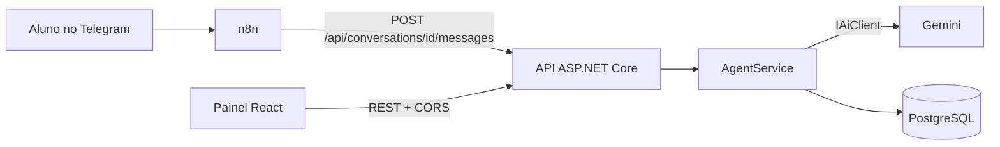

# Agente de IA para atendimento com painel de análise de conversas

Um agente de IA atende, pelo Telegram, alunos de um curso fictício de idiomas (a **Lingua Viva Idiomas**). Um painel web interno permite que a equipe leia as conversas, marque cada resposta do agente como **Boa** ou **Falha** (com comentário) e acompanhe a taxa de falhas por versão do prompt. As falhas viram exemplos para melhorar o prompt, e cada versão é documentada com antes e depois (veja [Melhoria de prompt](#melhoria-de-prompt-v1--v2)).

Projeto de portfólio em **.NET 8, React e IA**. O escopo completo está em [docs/PRD.md](docs/PRD.md).

## Arquitetura



A API segue três camadas:

```
Controllers (HTTP)  →  Services (regras e chamada da IA)  →  AppDbContext (dados)
```

| Pasta | Responsabilidade |
|---|---|
| `src/Api/Controllers` | Só HTTP: recebe a requisição e escolhe o status code. Nenhuma regra de negócio. |
| `src/Api/Services` | Regras: criar ou reaproveitar a conversa, montar o histórico, avaliar respostas, estatísticas. |
| `src/Api/Ai` | `IAiClient` (a interface) e `GeminiClient` (a implementação com `HttpClient`). |
| `src/Api/Models` | `Entities` (formato do banco) e `Dtos` (contrato da API), separados. |
| `src/Api/Prompts` | Prompt de sistema versionado (`system-v1.txt`, `system-v2.txt`) e a base de conhecimento do curso. |
| `tests/Api.Tests` | xUnit: serviços, cliente do Gemini, prompts e endpoints. |
| `web/` | Painel React + TypeScript (Vite). |
| `n8n/` | Fluxo do Telegram exportado (JSON, sem segredos). |

### Como funciona o fluxo de uma mensagem

1. O aluno escreve ao bot do Telegram, que chama o webhook do **n8n**.
2. O n8n confere o segredo do webhook, chama `POST /api/conversations` (cria ou reaproveita o aluno e a conversa pelo `chatId`) e depois `POST /api/conversations/{id}/messages`.
3. O `AgentService` salva a mensagem do aluno, carrega as últimas **20** mensagens, monta o prompt (instruções + base de conhecimento) e chama o `IAiClient`.
4. A resposta é salva com a **versão do prompt** usada e devolvida ao n8n, que a envia ao Telegram.
5. Se a IA falhar ou demorar mais de 20 s, a mensagem do aluno continua salva, a resposta **não** é gravada, a API devolve **502** e o n8n responde com um aviso fixo.

## Como rodar

**Pré-requisitos:** .NET 8 SDK, Node 22, Docker Desktop (aberto), uma chave da API do Gemini e, para o canal Telegram, um bot criado no BotFather.

```bash
# 1. Banco (PostgreSQL na porta 5433 do host)
docker compose up -d db

# 2. Chave do Gemini (fica fora do repositório, nos user-secrets)
dotnet user-secrets set "GEMINI_API_KEY" "<sua chave>" --project src/Api

# 3. API (aplica as migrations ao subir). Swagger em http://localhost:5080/swagger
dotnet run --project src/Api

# 4. Painel em http://localhost:5173
cd web && npm ci && npm run dev
```

**Canal Telegram (opcional):** copie `.env.example` para `.env`, preencha `TELEGRAM_BOT_TOKEN` e `TELEGRAM_WEBHOOK_SECRET` (qualquer texto longo e aleatório) e, com a API rodando, execute:

```powershell
powershell -ExecutionPolicy Bypass -File scripts/telegram-up.ps1
```

O script sobe o túnel Cloudflare e o n8n, importa e publica o fluxo de `n8n/` e registra o webhook do bot na URL do túnel. A URL do túnel muda a cada subida, então o script registra o webhook de novo toda vez.

**Testes:**

```bash
dotnet test                              # backend
cd web && npm run lint && npm run build  # frontend
```

Os testes não precisam de Docker nem de chave de IA: usam SQLite em memória e um cliente de IA falso. O mesmo roda no GitHub Actions (`.github/workflows/ci.yml`).

## API

| Método e rota | O que faz |
|---|---|
| `POST /api/conversations` | Cria aluno e conversa pelo `telegramChatId` (**201**) ou devolve a existente (**200**). |
| `GET /api/conversations?hasFailures=true` | Lista conversas, mais recentes primeiro; o filtro traz só as que têm falhas marcadas. |
| `GET /api/conversations/{id}` | Conversa com todas as mensagens em ordem cronológica. |
| `POST /api/conversations/{id}/messages` | Recebe a mensagem do aluno e devolve a resposta do agente (**502** se a IA falhar). |
| `PATCH /api/messages/{id}/review` | Marca uma resposta do agente como `Good` ou `Failure`, com comentário. |
| `GET /api/stats` | Totais, taxa de falhas e recorte por versão do prompt. |

## Decisões de design

| Decisão | Por quê |
|---|---|
| Interface `IAiClient` | Isola o provedor de IA: dá para trocar de provedor e testar o `AgentService` com um cliente falso, sem chamar a API real. |
| DTOs separados das entidades | O contrato HTTP evolui sem migration, e nenhum campo interno vaza pela API. |
| Um projeto `Api` em camadas por pasta | Fácil de explicar. Clean Architecture em quatro projetos triplicaria o código sem ganho neste porte. |
| `DbContext` direto nos Services | Ele já é repositório e unit of work; uma camada extra seria abstração desnecessária. |
| n8n para o canal | A integração fica fora do código C#: trocar o Telegram por outro canal não muda a API. |
| Uma conversa por aluno, com as últimas N mensagens | Simples, testável e controla o contexto enviado à IA. |
| Resposta da IA não gravada em caso de falha | Evita lixo no histórico; o 502 é explícito e o canal decide o texto de aviso. |
| `PromptVersion` salvo em cada resposta | Torna mensurável o efeito de mudar o prompt. |
| Fluxo do n8n com Webhook e segredos em variáveis de ambiente | O JSON exportado não leva segredo e não exige criar credenciais na interface do n8n. O segredo do webhook também impede que qualquer pessoa envie mensagens falsas ao fluxo. |
| SQLite em memória nos testes | Mais fiel a um banco relacional do que o provider InMemory do EF. |

## Melhoria de prompt (v1 → v2)

### 1. O problema

Com o prompt **v1** o agente acertava os fatos, mas as respostas tinham dois problemas de formato, visíveis no Telegram:

- **Markdown que o Telegram não renderiza.** Respostas com `**negrito**` e listas com `-` aparecem com os símbolos literais na tela do aluno.
- **Respostas longas, com informação que ninguém pediu.** Perguntar o preço do curso rendeu um parágrafo com matrícula, material didático e desconto.

### 2. Como foi medido

Um roteiro fixo de **10 perguntas** ([scripts/eval-prompt.mjs](scripts/eval-prompt.mjs)) é enviado, na mesma ordem, a uma conversa nova por versão. Ele cobre preço, horário, matrícula, cancelamento, um curso que não existe, um assunto fora do tema, uma conta (primeiro mês somando tudo), uma informação ausente da base (filial, desconto para estudante) e uma regra de idade.

Cada resposta é avaliada pela rubrica abaixo e marcada no painel (`Good` ou `Failure`, com o motivo no comentário):

- **Falha** se usar formatação Markdown (negrito, itálico, lista, título ou crase);
- **Falha** se passar de 3 frases ou de 300 caracteres;
- (verificação manual) **Falha** se inventar informação que não está na base ou responder fora do tema.

As duas primeiras regras são verificadas pelo próprio script. Nas 20 respostas, nenhuma inventou fato nem saiu do tema.

### 3. Prompt antes (`system-v1.txt`)

```text
Você é a atendente virtual da Lingua Viva Idiomas, um curso de idiomas. Você conversa com alunos e interessados pelo Telegram.

Regras:
- Responda sempre em português do Brasil, de forma cordial e objetiva.
- Responda apenas com base na "Base de conhecimento" abaixo.
- Se a informação não estiver na base, diga que não tem essa informação e sugira falar com a secretaria pelo contato indicado na base. Não invente preços, horários ou regras.
- Se o assunto não for sobre o curso, explique educadamente que só pode ajudar com assuntos da Lingua Viva Idiomas.
- Mantenha as respostas curtas.
```

### 4. Prompt depois (`system-v2.txt`)

```text
Você é a atendente virtual da Lingua Viva Idiomas, um curso de idiomas. Você conversa com alunos e interessados pelo Telegram.

Conteúdo:
- Responda sempre em português do Brasil, de forma cordial e objetiva.
- Responda apenas com base na "Base de conhecimento" abaixo.
- Responda somente o que foi perguntado. Não ofereça preços, descontos ou regras que a pessoa não pediu.
- Se a informação não estiver na base, diga que não tem essa informação e indique a secretaria com um único contato (telefone ou e-mail). Não invente preços, horários ou regras.
- Se o assunto não for sobre o curso, explique educadamente que só pode ajudar com assuntos da Lingua Viva Idiomas.

Formato (as mensagens são lidas no Telegram, que não formata texto):
- Escreva em texto simples. Nunca use asteriscos, negrito, itálico, listas com hífen ou marcadores, títulos ou crases.
- Se precisar citar vários itens, escreva tudo numa frase, separando por vírgulas.
- Use no máximo 3 frases curtas e até cerca de 300 caracteres.
```

O que mudou: "mantenha as respostas curtas" (vago) virou um limite concreto; a proibição de Markdown ganhou o **motivo** (o Telegram não formata); e ganhou a regra de responder só o que foi perguntado e de indicar um único contato quando não souber.

### 5. Resultado

| Métrica (10 perguntas) | v1 | v2 |
|---|---|---|
| Respostas com Markdown | 4 | **0** |
| Respostas longas (> 3 frases ou > 300 caracteres) | 4 | **0** |
| Respostas avaliadas como Falha | 5 | **0** |
| Tamanho médio (caracteres) | 239 | **153** |
| Maior resposta (caracteres) | 376 | **241** |

Exemplo, para *"Quanto vou gastar no primeiro mês de inglês em grupo, somando tudo?"*:

- **v1** (351 caracteres, Markdown): `No primeiro mês da turma em grupo padrão, o valor total é de **R$ 660,00**. O detalhamento dos custos iniciais é: - **Mensalidade:** R$ 390,00 - **Taxa de matrícula:** R$ 90,00 ...`
- **v2** (241 caracteres, texto simples): `No primeiro mês da turma em grupo regular, o valor total é R$ 660,00, somando a mensalidade de R$ 390,00, o material de R$ 180,00 e a matrícula de R$ 90,00. ...`

A taxa de falhas por versão também aparece no resumo do painel (`GET /api/stats`, campo `byPromptVersion`). A versão ativa é `Agent:PromptVersion` no `appsettings.json` (hoje `v2`); para repetir o experimento com o v1, suba a API com `Agent__PromptVersion=v1` e rode o roteiro de novo.

### 6. Limitações desta medição

- São só 10 perguntas, em uma rodada por versão, e a IA não é determinística: os números mostram a tendência, não uma garantia.
- Duas das três regras da rubrica são mecânicas. A verificação de fatos foi manual, feita por leitura.
- O v2 ainda cita, sem pedir, o preço da turma intensiva de sábado ao responder sobre o curso em grupo (perguntas 1 e 7). Não infringe a rubrica, mas a regra "responda somente o que foi perguntado" não foi seguida à risca.

## Limitações conhecidas

- **Sem autenticação:** a API e o painel são abertos. É um projeto de demonstração local; o próximo passo seria JWT ou ASP.NET Identity.
- **Concorrência na criação do aluno:** duas requisições simultâneas com o mesmo `chatId` novo podem colidir no índice único do banco. Na prática o Telegram entrega uma mensagem por vez.
- **Túnel temporário:** o túnel rápido do Cloudflare muda de URL a cada subida; o script `telegram-up.ps1` registra o webhook de novo, mas o bot só responde enquanto a API, o Docker e o túnel estiverem de pé na máquina.
- **Sem testes automatizados do painel React:** foi verificado manualmente no navegador (lint e build rodam no CI).

## Próximos passos

- Autenticação da equipe no painel.
- Tags de tipo de falha e gráficos por versão do prompt.
- Rodar o roteiro de perguntas no CI a cada mudança de prompt e comparar com a rubrica.
- Dockerizar a API para subir tudo com um único `docker compose up`.
