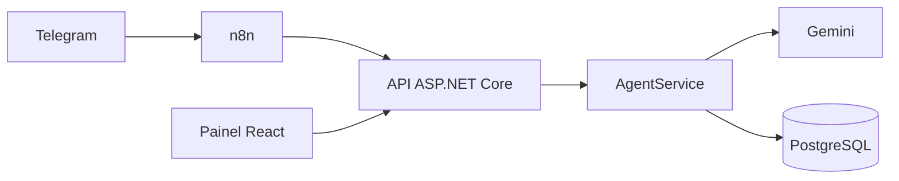

# Agente de atendimento com painel de revisão

Um agente de IA que responde alunos de um curso de idiomas inventado (a Lingua Viva Idiomas) pelo Telegram, e um painel web onde a equipe lê as conversas e marca cada resposta do agente como boa ou com falha, com comentário.

Fiz este projeto para praticar .NET, React e integração com IA num caso pequeno, mas completo. A parte que mais me interessou foi o ciclo de melhoria: marcar falhas reais no painel, ajustar o prompt e medir de novo. Está documentado mais abaixo, em "Melhoria de prompt".

Usei ASP.NET Core 8 com EF Core e PostgreSQL no backend, React com TypeScript (Vite) no painel, a API do Gemini como modelo, n8n para ligar o Telegram à API, e xUnit, Docker Compose e GitHub Actions no resto. O escopo original está em [docs/PRD.md](docs/PRD.md).

## Como rodar

Você precisa do .NET 8 SDK, do Node 22, do Docker Desktop aberto e de uma chave da API do Gemini.

```bash
# banco (PostgreSQL, porta 5433 do host)
docker compose up -d db

# chave do Gemini, guardada fora do repositório
dotnet user-secrets set "GEMINI_API_KEY" "<sua chave>" --project src/Api

# API: aplica as migrations ao subir. Swagger em http://localhost:5080/swagger
dotnet run --project src/Api

# painel em http://localhost:5173
cd web
npm ci
npm run dev
```

O comando de `user-secrets` imprime o valor da chave no terminal ao salvar, então cuidado se estiver gravando a tela.

A porta do banco é 5433 porque a 5432 costuma estar ocupada por um PostgreSQL instalado na máquina.

Para o Telegram, crie um bot no BotFather, copie `.env.example` para `.env` e preencha `TELEGRAM_BOT_TOKEN` e `TELEGRAM_WEBHOOK_SECRET` (qualquer texto longo e aleatório). Com a API rodando:

```powershell
powershell -ExecutionPolicy Bypass -File scripts/telegram-up.ps1
```

O script sobe um túnel do Cloudflare e o n8n, importa o fluxo de `n8n/` e registra o webhook do bot na URL do túnel. Essa URL muda toda vez que o túnel reinicia, por isso o script registra o webhook de novo a cada execução. O bot só responde enquanto a API, o Docker e o túnel estiverem de pé na sua máquina.

Os testes não precisam de Docker nem de chave de IA, porque usam SQLite em memória e um cliente de IA falso:

```bash
dotnet test
cd web && npm run lint && npm run build
```

O GitHub Actions roda essas mesmas etapas a cada push.

## Como está organizado



A API tem três camadas: controllers, services e o `AppDbContext`. O controller só trata HTTP (recebe a requisição e escolhe o status). As regras ficam nos services: criar ou reaproveitar a conversa, montar o histórico, avaliar respostas, calcular estatísticas. O acesso ao banco passa direto pelo `DbContext`, sem repositório no meio.

Dentro de `src/Api`: `Controllers`, `Services`, `Ai` (a interface `IAiClient` e o `GeminiClient`), `Models` (entidades e DTOs separados), `Data` (contexto e migrations) e `Prompts` (as versões do prompt e a base de conhecimento do curso). Os testes estão em `tests/Api.Tests`, o painel em `web/` e o fluxo do n8n em `n8n/`.

Endpoints:

```
POST  /api/conversations                    cria ou reaproveita a conversa de um aluno (201 ou 200)
GET   /api/conversations?hasFailures=true   lista as conversas; o filtro traz só as que têm falhas
GET   /api/conversations/{id}               a conversa com todas as mensagens
POST  /api/conversations/{id}/messages      recebe a mensagem do aluno e devolve a resposta do agente
PATCH /api/messages/{id}/review             marca uma resposta como Good ou Failure, com comentário
GET   /api/stats                            totais e taxa de falhas, também por versão do prompt
```

## O caminho de uma mensagem

O aluno escreve para o bot e o Telegram chama o webhook do n8n. O n8n confere o segredo do webhook e chama a API: primeiro `POST /api/conversations`, que acha ou cria o aluno e a conversa pelo `chatId`, depois `POST /api/conversations/{id}/messages`.

Aí o `AgentService` salva a mensagem do aluno, pega as últimas 20 mensagens da conversa, junta o prompt de sistema com a base de conhecimento e chama o Gemini pelo `IAiClient`. A resposta é salva junto com a versão do prompt que a gerou e volta pelo n8n até o Telegram.

Se o Gemini falhar ou passar de 20 segundos, a mensagem do aluno continua salva, a resposta do agente não é gravada e a API devolve 502. O n8n então manda um aviso fixo pedindo para tentar de novo.

## Decisões

O Gemini fica atrás de uma interface, `IAiClient`. O `AgentService` não sabe qual provedor está do outro lado, então dá para testá-lo com um cliente falso, sem rede e sem chave, e trocar de provedor mexe em um arquivo só.

A API devolve DTOs, não as entidades do banco. Assim o contrato HTTP pode mudar sem migration e nenhum campo interno vaza.

Usei um único projeto organizado por pastas. Separar em quatro projetos (Domain, Application e assim por diante) me pareceu muito código de ligação para o tamanho disto.

O Telegram entra por um fluxo do n8n e não por código C#. Se um dia o canal mudar, a API continua igual. No fluxo usei o nó Webhook e deixei os segredos em variáveis de ambiente, o que faz o JSON exportado não ter segredo nenhum e dispensa criar credenciais na interface do n8n. O segredo do webhook também impede que qualquer pessoa mande mensagens falsas para o fluxo.

Cada resposta do agente guarda a versão do prompt usada. É isso que permite comparar a taxa de falhas entre versões.

Nos testes de serviço uso SQLite em memória em vez do provider InMemory do EF, porque ele se comporta mais como um banco relacional de verdade.

## Melhoria de prompt

Com o prompt v1 o agente acertava os fatos, mas dois problemas de formato apareciam no Telegram. O primeiro era Markdown: respostas com `**negrito**` e listas com hífen chegavam ao aluno com os símbolos à mostra, porque o Telegram não renderiza isso. O segundo era tamanho: perguntar o preço do curso rendia um parágrafo com matrícula, material e desconto que ninguém tinha pedido.

Para medir, montei um roteiro fixo de 10 perguntas em [scripts/eval-prompt.mjs](scripts/eval-prompt.mjs). Ele cobre preço, horário, matrícula, cancelamento, um curso que não existe, um assunto fora do tema, uma conta (quanto gasto no primeiro mês, somando tudo), duas informações que não estão na base (filial e desconto de estudante) e uma regra de idade. O roteiro roda numa conversa nova por versão e eu marquei cada resposta no painel seguindo três regras: é falha se usar Markdown, se passar de 3 frases ou 300 caracteres, ou se inventar algo que não está na base. As duas primeiras o script checa sozinho. A terceira foi por leitura, e nas 20 respostas ninguém inventou nada.

No v2 troquei o "mantenha as respostas curtas" por limites concretos e expliquei o motivo da regra de formato. Estas são as partes novas de [system-v2.txt](src/Api/Prompts/system-v2.txt):

```text
Responda somente o que foi perguntado. Não ofereça preços, descontos ou regras que a pessoa não pediu.

Formato (as mensagens são lidas no Telegram, que não formata texto):
- Escreva em texto simples. Nunca use asteriscos, negrito, itálico, listas com hífen ou marcadores, títulos ou crases.
- Se precisar citar vários itens, escreva tudo numa frase, separando por vírgulas.
- Use no máximo 3 frases curtas e até cerca de 300 caracteres.
```

O v2 também passou a indicar um único contato da secretaria quando não sabe a resposta, em vez de despejar telefone e e-mail.

| 10 perguntas | v1 | v2 |
|---|---|---|
| Respostas com Markdown | 4 | 0 |
| Respostas longas | 4 | 0 |
| Marcadas como falha | 5 | 0 |
| Tamanho médio, em caracteres | 239 | 153 |

Na pergunta da conta do primeiro mês, o v1 respondeu em 351 caracteres com negrito e uma lista de três itens. O v2 respondeu em 241, numa frase corrida: `No primeiro mês da turma em grupo regular, o valor total é R$ 660,00, somando a mensalidade de R$ 390,00, o material de R$ 180,00 e a matrícula de R$ 90,00.`, mais uma frase sobre a turma intensiva.

O painel mostra 5 falhas em 11 avaliações para o v1, e não em 10, porque a resposta ao `/start` que fiz pelo Telegram também está lá (e foi marcada como boa). A versão ativa fica em `Agent:PromptVersion` no `appsettings.json`, hoje `v2`. Para repetir a medição do v1, suba a API com a variável de ambiente `Agent__PromptVersion=v1` e rode o roteiro de novo.

Esta medição é pequena: dez perguntas, uma rodada por versão, e o modelo não é determinístico. Mostra uma tendência, não uma garantia. Além disso, o v2 ainda cita o preço da turma intensiva sem ser perguntado nas perguntas 1 e 7, então a regra de responder só o que foi pedido não é seguida à risca.

## O que ficou de fora

Não tem login: a API e o painel são abertos, o que serve para uma demonstração local, mas não para produção. Um próximo passo natural seria autenticar a equipe com JWT.

Se duas requisições com o mesmo `chatId` novo chegarem ao mesmo tempo, o índice único do banco recusa a segunda. No Telegram isso não acontece na prática, porque as mensagens de um mesmo chat chegam uma por vez.

O painel React não tem testes automatizados. Conferi o comportamento no navegador, e o lint e o build rodam no CI.

Gostaria de rodar o roteiro de perguntas no CI a cada mudança de prompt, mas isso gastaria chamadas reais da API a cada push, então deixei manual.

A API também ainda roda fora do Docker. Colocá-la no Compose permitiria subir tudo com um único comando.
